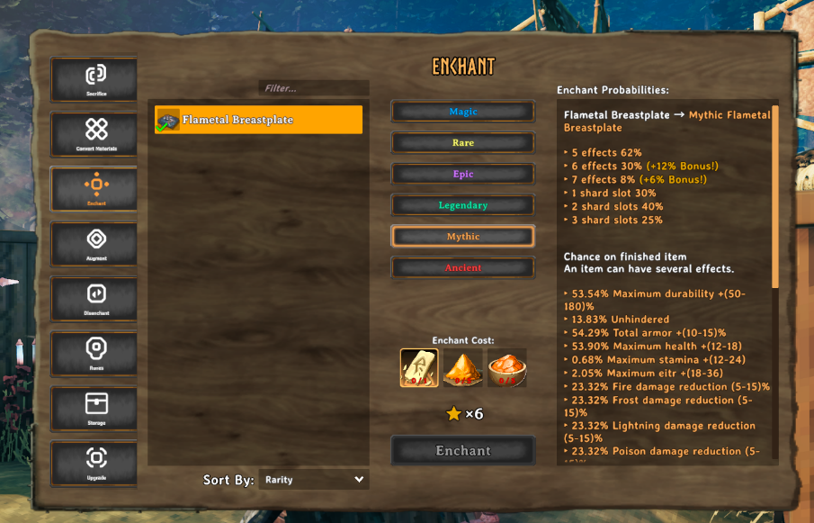
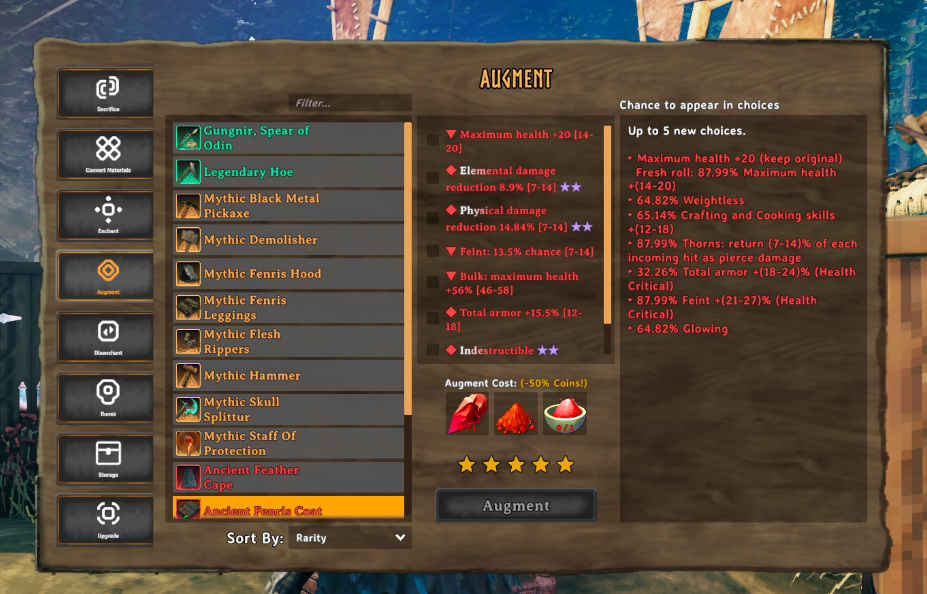
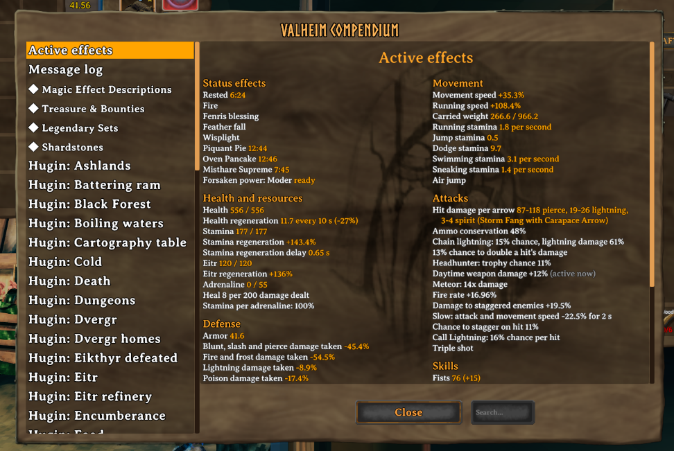
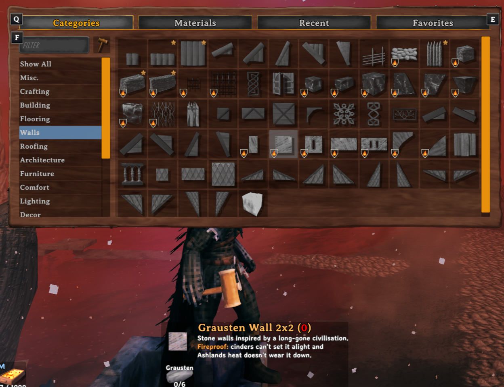

# EpicLoot Progression Fix

These are the EpicLoot changes we use on our server: loot that follows your crafting progress, better blocking, fewer wasted enchantments, and less time spent moving ingredients between chests.

**We strongly recommend using all the companion mods listed below, with the same pack settings.** That is the setup we play with, and many of these features rely on those mods working together.

## Screenshots

Enchant shows each effect's chance on the finished item before you spend anything.

Augment shows each effect's chance to appear among your new choices.

Active effects gathers your health, defenses, movement, attacks and every enchantment you wear in one page of the raven book.

In the Ashlands, the hammer menu marks the pieces that can't catch fire.

## Performance

**World Performance 0.11.3 or newer is recommended on the server and every client.** It provides the game performance fixes; Progression Fix handles loot, gameplay and its own interface. Without it on the server, creatures stay with a lagging player instead of moving to one whose connection keeps up.

## What it doesn't change

Progression Fix doesn't add new mobs, bosses, biomes or items. It isn't meant to introduce a whole new set of gameplay systems.

The aim is to stay as close to **vanilla Valheim + EpicLoot** as possible: keep the game we enjoy, fix things that don't work properly, adjust some balance and cut down on repetitive chores. The changes should fit naturally into what's already there.

## What it changes

- **Loot follows your progress.** Craft equipment to unlock its enchanted drops from enemies, chests and unidentified rewards. Buying, finding or upgrading it does not count. Loot keeps its source’s progression limits.
- **Rewards match the encounter.** Bosses and bounty targets guarantee enchanted equipment. Main bounty targets also drop coins and bounty tokens according to their contract's biome, shared between players, in addition to Haldor's reward. Nemesis minibosses drop the same amounts for their own biome. Star scaling, elite runestones, Luck, Riches and Hoarding receive corrections, including rewards above five stars and limits on multiplying rare crafting materials.
- **Enchanting wastes less.** New enchantments must work on their equipment and incompatible sockets explain their restrictions. Enchant shows each effect's chance on the finished item; Augment shows its chance of appearing among your choices. Runes retain extraction power through etching, socketing and tempering; matching runes stack.
- **Combat gives you more control.** Raise your guard to cancel a swing, block after armor and resistances, and benefit from stronger shields, more forgiving parries, blocks that grow against starred creatures and on harder worlds, and a broken guard that still blocks. Fixes cover bows, crossbows, volleys, ammunition bonuses, recall and triggered attacks. Eligible targets and batch-crafted items each award skill experience.
- **Character bonuses work together.** Health, stamina, eitr, armor, carrying capacity, regeneration and skill bonuses account for your equipment and active effects. Buff meads can be refreshed near expiry, and automatic healing meads respond to actual health loss.
- **Adventures stay worthwhile.** Repeat boss fights grow harder, Nemesis ambushes vary, and configured dungeons replenish enemies and original treasure while preserving your belongings and builds. Bounties spread out and complete when their main target dies; their creatures roll stars like the creatures around them before adding their bounty stars, and their extra health multiplies the health from those stars; old unclaimed contracts receive EpicLoot's increased coin and token rewards. Andvaranaut tracks accepted contracts and unopened treasure, and its finder extracts into a rune for a shardstone slot.
- **Crafting and gathering take fewer clicks.** Craft in batches from chosen nearby storage, including your attached cart. Bulk actions load machines, cook, ferment, harvest and collect outputs. Material conversions support multiple selections, and Lucky Craft saves crafting and upgrade materials.
- **Equipment and storage are easier to manage.** Swap outfits with armor stands, equip from shared chests, and move socketed runes and shardstones with number keys. Faster wearable changes, improved sorting and stacking, protected favorites, and safer chest transfers reduce inventory chores.
- **Useful information is easier to find.** Active effects collects your current bonuses in one place. Equipment previews account for your character, while skill descriptions, enchanting panels, cooking prompts, ammunition counts and health bars show clearer information. Hold Shift for extra detail.

## Other improvements

- **Protection and summons.** Staff of Protection reaches allies within 20 m, absorbs falls and ongoing damage, displays remaining HP, refreshes on recast and trains its caster when broken. Summons appear on every completed cast, show their names, gain working health and movement bonuses, wait two of their own body lengths from you, take on only enemies near you, ignore peaceful wildlife, follow through dungeon doors and can be dismissed with their staff. Skeletons and Spirit Caller animals heal to full in about 6 minutes out of combat, with no feeding. Spirit Caller animals of every kind share one follower limit, and their caster can ride a wolf, moose or bear without a saddle. Starred spirit animals stay ghostly all over.
- **Taming and riding.** Animals find food more reliably, heal faster when fed and breed over distances suited to their size. Tames spare player buildings and crops. Mount movement, steering, stamina, harpooning and Stay orders receive fixes.
- **Ships and carts.** Steering responds promptly, sailing shardstones improve rowing, and passengers can use storage underway. Ship holds are larger; carts gain crafting-based durability, recover from buried wheels and keep their shafts up when pulled at a fast sprint. Ships, carts and siege machines can be taken apart with Ctrl + middle click at a workbench, returning their materials and cargo.
- **Building, farming and resting.** Comfort reaches across floors, ComfortMe previews additions, a hammer overlay shows ordinary spawn protection, and in the Ashlands the hammer menu marks pieces that can't catch fire. A setting per festival keeps its pieces and recipes available all year; the pack does this for Halloween's Jack-o-turnip and pointy hat. Planting grids, crop and vine regrowth, nests, sap production, ore support and mining drops receive fixes. Enemies pause through sleep and waking.
- **Recipes, traders and progression.** Inventory-row purchases follow boss progress, with a third expansion available. The Bog Witch offers every feast spice immediately. Recipe and refinement-idol corrections accompany configurable boss requirements for smelting advanced metals.
- **Movement and exploration.** Swimming benefits from skill, jumping handles uneven ground and ice more consistently, and Air Jump works from water. More weapons clear mist, dropped items slow down on ice, and unreachable graves move into reach.
- **Creatures and world conditions.** Paths, spawn positions and melee reach account for creature size, and large creatures aim their melee attacks at enemies above or below them. Creatures that fall into the water climb back out onto ice and ledges. Starred attacks, bounty strength, Nemesis behavior and kill credit receive corrections, and a wild Hexen's blasts spare most of a base's buildings and tames. Fuling villages, tar pits and other outdoor encounters populate within your simulation range. Fuling berserkers roam the Plains at night in place of about one Vile in five. The red water of the boiling Ashlands sea shows at every hour. Settings control spawn distances, late-biome pursuit and shared weather; creatures can move off a lagging player’s connection.
- **Visibility and personal controls.** Buildings, terrain, creatures and firelight remain visible farther away. Garden lights work independently of fires. Personal draw-distance choices, camera zoom, an optional FPS counter and rebindable shortcuts accompany quieter notifications.
- **Multiplayer and server support.** Server-wide chat connects with Discord, including readable mentions, achievements, player status and death reports with daily rankings. ServerCharacters gains first-join enrollment, verified saves and private item, currency and treasure-find records. Favorites, PvP choices and Nemesis scores persist, and connection failures give clearer recovery options.

## Mods we use

**We recommend the whole setup, including its configuration.** Installing the same mods with different settings will give you different loot, recipes, dungeon resets and balance. [TenemoPack](https://valheim.hexium.gg/mods/Tenemo/TenemoPack) installs them with their settings through Gale. It leaves out ServerCharacters, Dyrr, FastLink, DiscordBot_AWL, DiscordConnector and LetMeSleep, which only suit our own server.

- **Loot and combat:** EpicLoot, StarLevelSystem, Drop That, FortifySkillsReborn, SkilledCarryWeight and CombatStats.
- **Crafting and inventory:** AAA_Crafting, AzuCraftyBoxes, AzuWorkbenchTweaks, Quick Stack Store Sort Trash Restock, EquipmentAndQuickSlots, MultiUserChest, ItemStacksItemWeights and MouseTweaks.
- **Building and farming:** PlantEverything, PlantEasily, AzuAreaRepair, Better Beehives, ComfortMe and Treadwell.
- **Travel and animals:** Sailing, QuickCart, Better Wisps, WieldEquipmentWhileSwimming, TameRidingOverhaul and Venture Floating Items.
- **Everyday conveniences:** LongerDays, NoSmokeStayLit, ClearSkies and LetMeSleep.
- **Interface:** BetterUI ForeverMaintained, FedoHud, Ammo Count by aedenthorn Fixed, AzuClock, Ship Stats, TrueInstantLootDrop and Unshamed.
- **Multiplayer:** BetterNetworking Valheim, Network Performance System, ServerCharacters, Dyrr, FastLink, Venture Logout Tweaks, DiscordBot_AWL and DiscordConnector.

The pack also includes BepInExPack Valheim, Jotunn, JsonDotNET, YamlDotNet and ConditionalConfigSync.

## Installation

Install Progression Fix and its required dependencies through your mod manager: BepInExPack Valheim 5.4.2360, Jotunn 2.30.2 and EpicLoot 0.15.6, then World Performance 0.11.3 or newer from Hexium. Gale supports both Thunderstore and the Hexium packages used in this setup.

The server and every player need the same Progression Fix version and matching gameplay mods, and the server refuses a client on another Progression Fix version. Use the pack's separate client and server lists for the companion mods. To hold clients to a whole pack, put its plugins in the server's `BepInEx/config/client-plugins.txt`, one `GUID|version|name` line each. A client is then refused for running a plugin only the server should run, unless Dyrr's `dyrr-mods.txt` admits it.

Settings are in `BepInEx/config/valheim.epiclootprogressionfix.cfg`. Settings marked **Synced with Server** follow the server; personal controls and supported display settings stay local.

## Removal

Back up your saves first. Remove trinkets and utility items without visible models from armor stands using E, and empty the added ship-storage rows before reverting to smaller grids. If you still have legacy Starter Gear, load and save the characters and containers holding it before uninstalling. Remove the add-on from the server and every client together.

## Report a problem

Report bugs and ideas on [GitHub](https://github.com/Tenemo/valheim-epicloot-progression-fix/issues), or message `tenemo` on Discord. Include the mod's version and your `BepInEx/LogOutput.log`.

## Credits

EpicLoot is by RandyKnapp. Built with AI assistance. Release notes are in `CHANGELOG.md`.
